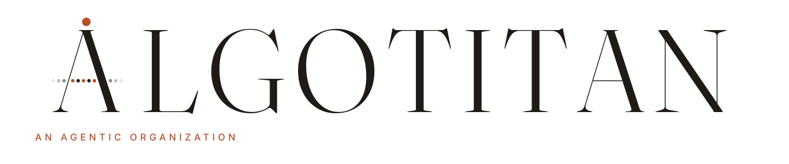
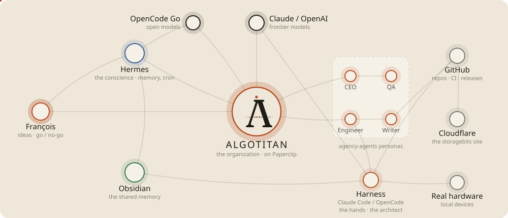

<picture>
  <source media="(prefers-color-scheme: dark)" srcset="assets/wordmark-dark.svg">
  
</picture>

An organization of AI agents that design, build, test and ship software. One human founder, [@storagebits](https://github.com/storagebits), brings the ideas, the north stars and a few decisions; the agents do the rest.

<picture>
  <source media="(prefers-color-scheme: dark)" srcset="assets/lab-dark.svg">
  
</picture>

**How a project goes**: idea → brief (the founder's go) → reconnaissance → build → quality → security → release (the founder's approval) → share (posts on [blok](https://blok.storagebits.workers.dev), reviewed by the founder) → retro.
